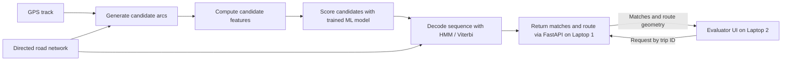

# PathSnap problem and architecture

PathSnap reconstructs a vehicle's route through a directed road network from a time-ordered series of GPS observations. GPS drift can place a sample closer to a parallel road than the road the vehicle used. Individually plausible matches can produce an impossible route when the selected arcs have no directed path between them. A gap in sampling can also hide several traversed arcs, so consecutive GPS samples may match roads that do not share an endpoint.

## Trip inputs

Each trip has whitespace-delimited files without headers. Node and arc IDs are implicit zero-based row indices within that trip's network.

| File | Columns | Role |
| --- | --- | --- |
| `.track` | Longitude, latitude, timestamp in seconds | GPS observations in trip order. Preserve the source row index as the observation ID when cleaning or filtering. |
| `.nodes` | Longitude, latitude | Location of each road-network node. |
| `.arcs` | From-node ID, to-node ID | Directed road segment between two node rows. Validate both endpoint IDs before building segment geometry. |
| `.route` | Arc ID | Optional chronological reference sequence. Resolve each ID against the trip's arc rows and preserve sequence order, including repeated arcs. |

Prediction takes the track and road network as input. Reference routes support offline label development and evaluation where authorized. Evaluator references stay on the server for evaluation and outside prediction and UI payloads.

## Candidate and reference alignment

A candidate is a directed arc that might explain one GPS observation, identified by `(trip_id, observation_index, arc_id)`. A reference route records which arcs the vehicle traversed in sequence. Multiple samples can fall on one arc, some arcs can be traversed between samples, and a route can revisit an arc. Row offsets and route membership alone therefore cannot establish the correct candidate label for an observation.

Investigate a monotonic alignment of GPS observations to positions along the reference traversal. Check alignment quality on representative training trips before using the inferred associations as labels. Record ambiguous associations and distinguish them from candidate misses, where an accepted reference association points to an arc outside the generated candidate set. Keep all observations from the same training trip together in validation splits and reserve evaluator trips for final evaluation.

## Sprint 1 implementation

The [development inventory](dataset.md) documents partition coverage and data quality. The parser uses a local equirectangular projection for metric segment distances. The geometric baseline predicts a closest arc per observation, and the [feature prototype](features.md) exports candidate rows and a separate provisional alignment. Label validation, candidate policy selection, and decoder behavior across gaps or unreachable transitions remain open.

## Planned inference outputs

Return one result per GPS observation in input order, keyed by its source index. Each result contains the selected arc ID or an explicit unmatched status. Return the reconstructed route as ordered directed arc IDs, including inferred connecting arcs where the decoder can bridge a gap. Represent breaks as separate route portions so the UI can draw them without implying a connection. Adjacent observations may select the same arc, while a traversal that revisits an arc can include that ID again.

## Planned architecture



Candidate generation narrows the search using distances in metres. Candidate features describe observation-to-arc fit, such as offset and heading agreement. The selected classifier provides emission scores for candidate arcs. The HMM uses those scores and transition scores based on directed network paths, elapsed time and plausible travel distance. Viterbi selects a sequence across observations, and connecting paths turn the decoded states into route geometry where feasible.

FastAPI runs inference on Laptop 1 and supplies the outputs needed by the map. The UI on Laptop 2 requests an evaluator trip by ID and draws the returned matches and route portions. Where reference data is available for authorized evaluation, the server computes metrics separately from prediction.

## Shared parser output

`pathsnap.preprocess.load_trip(directory)` returns a `Trip` with:

- `trip_id`: directory name.
- `observations`: ordered `Observation` records `{obs_id, lon, lat, timestamp_s}`.
- `observation_xy`: parser-projected metric coordinates in the same order as observations.
- `network.nodes`: `Node` records `{node_id, lon, lat}` with zero-based row IDs.
- `network.arcs`: directed `Arc` records `{arc_id, from_node_id, to_node_id}` with zero-based row IDs.
- `network.segments`: `ArcGeometry` records with projected endpoints in metres.
- `route`: ordered `RouteStep` records `{row_id, arc_id}`, or `None` when the route file is absent.

The parser validates coordinate, timestamp, endpoint, and route ID bounds. It retains coordinates in degrees and supplies projected geometry for metric distance calculations.

## Baseline output

`nearest_segment_predictions(trip, max_distance_m=250)` returns one record per GPS observation:

```json
{"obs_id": 0, "arc_id": 12, "distance_m": 7.231}
```

`arc_id` and `distance_m` are `null` if no segment is within the cutoff. This geometric nearest-segment method is a baseline only; it is not a trained ML model and does not use `.route`.

## Development map artifact

The CLI writes `<prefix>.json` and `<prefix>.html`. The JSON keeps the reference route in a separate field for development inspection; it is not passed into prediction. Do not send reference labels to the evaluator UI. The Folium HTML displays separate road, GPS, nearest-segment and optional reference-route layers. The reference layer starts hidden. It loads Leaflet and OpenStreetMap tiles over the internet.
